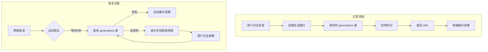

# 图片生成恢复系统 (Generation Recovery System)

> **状态**: ✅ 已实现并测试通过  
> **更新日期**: 2025-12-12

---

## 一、问题描述

**用户反馈**: 在任意模式下提交图片生成请求，等待几十秒后，积分被扣除 10 分，但生成的图片未显示，界面提示"网络错误"。

**关键矛盾**: 后台确认图片已成功生成并存储在 Supabase 的 `generated_results` 存储桶中，但用户看不到结果。

---

## 二、问题根源分析

### 2.1 问题时序图

```
用户 (前端)                后端 API                  Supabase                Gemini AI
    |                         |                         |                         |
    |--- 发起生成请求 -------->|                         |                         |
    |                         |--- 预检查积分 ---------->|                         |
    |                         |<-- 积分充足 ------------|                         |
    |                         |                         |                         |
    |                         |--- 调用 AI 生成 --------------------------------->|
    |                         |                         |                         |
    | (用户等待 30-60 秒)      |                         |                         |
    |                         |                         |                         |
    |                         |<-- AI 返回图片 (Buffer) -------------------------|
    |                         |                         |                         |
    |                         |--- 上传 generated_results -->|                    |
    |                         |<-- 上传成功 URL ----------|                         |
    |                         |--- 扣除积分 (RPC) ------>|                         |
    |                         |<-- 扣费成功 -------------|                         |
    |                         |                         |                         |
    |<== 返回 URL 给前端 ======|  <--- ⚠️ 问题发生点！    |                         |
    |                         |                         |                         |
    | ❌ 用户网络断开/慢，无法接收响应                       |                         |
    |                         |                         |                         |
    |  (前端显示网络错误)       |                         |                         |
```

### 2.2 根本原因

后端流程对服务器来说是"原子"操作，但对用户来说 **不是原子的**。

**执行顺序** (route.ts):
1. ✅ Gemini AI 成功生成图片
2. ✅ 上传到 Supabase `generated_results` 存储桶
3. ✅ 调用 RPC 扣除积分
4. ✅ 构建成功响应 `{ success: true, data: signedUrl }`
5. ❌ **将响应发送回前端** ← 问题发生点

**关键问题**: 积分扣除发生在用户收到结果 URL 之前。如果在最后一步用户的网络出现问题（断开、超时、代理中断），后端认为任务完成，但用户什么也看不到。

---

## 三、解决方案

我们采用了 **方案 1 (数据库记录) + 方案 3 (前端自动恢复)** 的组合策略：

### 3.1 方案架构



### 3.2 技术实现

| 层级 | 改动 | 说明 |
|:---|:---|:---|
| **数据库** | 新建 `generations` 表 | 持久化每次生成的元数据 |
| **后端 API** | `saveGenerationRecord()` | 生成成功后立即写入 DB |
| **后端 API** | `GET /api/generations` | 供前端查询恢复记录 |
| **前端** | 自动恢复逻辑 | 网络错误时自动轮询检查 |
| **前端** | 手动刷新按钮 | 自动恢复失败时的备用方案 |
| **前端** | 云端同步按钮 | 跨设备/清缓存后恢复历史 |

---

## 四、新增功能指南

### 4.1 自动恢复 (对用户透明)

当网络错误发生时，系统会自动：
1. 等待 5 秒（让后端 DB 写入完成）
2. 查询 `/api/generations?since=<请求时间>` 检查是否有新生成
3. 如果找到，自动展示结果
4. 如果未找到，最多重试 2 次

**用户无需任何操作**，大多数情况下会自动恢复成功。

---

### 4.2 手动刷新按钮

**位置**: 结果展示区域，在错误提示下方

**触发条件**: 自动恢复失败时显示

**使用方法**: 点击"重新获取图片"按钮

![手动刷新按钮示意]
```
┌────────────────────────────────┐
│                                │
│    📷 Result Area              │
│                                │
│   ⚠️ 网络错误，图片可能已生成    │
│                                │
│   ┌──────────────────────┐     │
│   │ 🔄 重新获取图片       │     │
│   └──────────────────────┘     │
│                                │
└────────────────────────────────┘
```

---

### 4.3 云端同步按钮

**位置**: 历史记录抽屉顶部

**用途**: 
- 跨设备恢复（手机生成的图片在电脑上查看）
- 浏览器缓存清空后恢复

**使用方法**: 打开历史记录侧边栏 → 点击"同步云端"按钮

---

### 4.4 性能日志 (开发者)

在浏览器控制台可查看生成耗时：

```
[Performance] Generation started at 2025-12-12T06:00:00.000Z
[Performance] Generation completed successfully in 35.2s
[Performance] Mode: STYLE_MODE, Start: ..., End: ...
```

---

## 五、技术细节

### 5.1 数据库表结构

```sql
create table public.generations (
  id uuid primary key default gen_random_uuid(),
  user_id uuid references auth.users on delete cascade not null,
  result_image_url text not null,
  original_image_url text,
  app_mode text not null,
  generation_params jsonb default '{}'::jsonb,
  created_at timestamptz default now()
);
```

### 5.2 文件改动清单

| 文件 | 类型 | 说明 |
|:---|:---:|:---|
| `supabase/generations_table.sql` | 新建 | 数据库表结构 |
| `app/api/generate/route.ts` | 修改 | 新增 `saveGenerationRecord()` |
| `app/api/generations/route.ts` | 新建 | 查询生成记录 API |
| `lib/api-client.ts` | 修改 | 自动恢复 + 云端同步 |
| `lib/historyService.ts` | 修改 | `syncFromCloud()` |
| `components/ResultDisplay.tsx` | 修改 | 手动刷新按钮 |
| `components/HistoryDrawer.tsx` | 修改 | 云端同步按钮 |
| `App.tsx` | 修改 | 恢复状态 + 性能日志 |

---

## 六、部署注意事项

> ⚠️ 上线前必须在 Supabase Dashboard 执行 SQL 脚本创建 `generations` 表，否则功能无法正常工作。

SQL 脚本位置: `supabase/generations_table.sql`