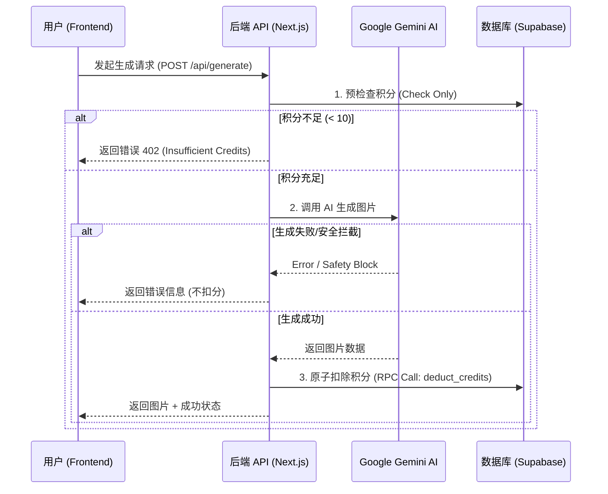

# 用户积分系统设计与实现文档 (Credit System PRD)

## 1. 概述 (Overview)
本文档详细描述了 StyleMorph AI Studio 的用户积分系统的设计原理、技术实现及未来扩展规划。该系统旨在通过积分（Credits）机制控制 API 资源消耗，防止滥用，并为未来的商业化变现奠定基础。

## 2. 核心业务规则 (Business Rules)

| 规则项 | 描述 | 实现方式 |
| :--- | :--- | :--- |
| **初始积分** | 新用户注册即送 **35 积分** | 数据库触发器 (`on_auth_user_created`) |
| **单次消耗** | 每次图片生成消耗 **10 积分** | 后端 API 配置常量 |
| **扣费时机** | **生成成功后扣费** (Success-based Deduction) | 后端逻辑控制 (`check` -> `generate` -> `deduct`) |
| **失败处理** | 生成失败（网络/安全拦截）**不扣分** | 异常捕获机制 (Try/Catch Block) |
| **并发控制** | 防止并发请求导致余额扣减错误 | 数据库原子操作 (RPC Function) |

## 3. 技术架构 (Technical Architecture)

系统采用 **后端强制校验** 模式，前端仅做展示，不做核心权限控制。



## 4. 详细实现 (Implementation Details)

### 4.1 数据库层 (Supabase PostgreSQL)

**表结构 (`public.profiles`)**
用户的积分数据与身份认证系统解耦，存储在独立的 `profiles` 表中。
- `id`: UUID (Foreign Key to `auth.users`)
- `credits`: Integer (Default: 35)

**关键数据库函数**

1.  **自动赠送触发器**:
    ```sql
    create or replace function public.handle_new_user() returns trigger as $$
    begin
      insert into public.profiles (id, email, credits)
      values (new.id, new.email, 35);
      return new;
    end;
    $$ language plpgsql security definer;
    ```

2.  **原子扣费函数 (RPC)**:
    解决高并发场景下的“竞态条件”（Race Condition），确保扣费数据强一致性。
    ```sql
    create or replace function deduct_credits(user_id uuid, amount int) returns void as $$
    begin
      update public.profiles
      set credits = credits - amount
      where id = user_id and credits >= amount;
    end;
    $$ language plpgsql security definer;
    ```

### 4.2 后端逻辑层 (`app/api/generate/route.ts`)

**安全配置**
- 必须配置 `SUPABASE_SERVICE_ROLE_KEY` 环境变量。
- 后端使用 Admin Client 绕过 RLS (Row Level Security) 进行扣分操作。
- **强制检查**: 如果 Service Key 缺失，服务将直接抛出 Server Error，禁止“免费后门”。

**逻辑流程**
1.  **Pre-Check (`checkCredits`)**: 读取用户当前积分。如果不足，直接返回错误，不发起 AI 请求。
2.  **Generation**: 执行耗时的 AI 生成任务。
3.  **Atomic Deduction (`deductCredits`)**: 生成成功后，调用 Supabase RPC `deduct_credits` 函数执行扣费。

### 4.3 前端交互层

**状态管理 (`AuthProvider.tsx`)**
- 在用户 Session 初始化时自动拉取积分。
- 提供 `refreshCredits()` 方法供组件调用。

**UI 组件 (`Sidebar.tsx`, `LandingPage.tsx`)**
- **实时展示**: 侧边栏和顶部导航实时显示剩余积分。
- **操作拦截**: 点击“生成”按钮时，前端先进行一次快速校验（`credits < 10`），减少无效的后端请求。
- **更新反馈**: 生成成功后，延迟执行 `refreshCredits()`，让用户看到积分减少的动画效果。

## 5. 安全性与扩展性 (Security & Extensibility)

### 安全性保障
1.  **Server-Side Enforcement**: 所有的逻辑判断都在后端完成，前端无法篡改。
2.  **Service Role Isolation**: 只有后端拥有修改积分的权限（普通用户只能通过 RLS 查看自己的积分）。
3.  **No Cost for Failure**: 只有拿到结果才扣费，避免因为网络波动或敏感词误杀导致的用户投诉。

### 未来扩展规划 (Roadmap)
1.  **充值系统对接**:
    - 新增 `orders` 表记录充值订单。
    - 对接 Stripe/WeChat Pay 支付 webhook。
    - 支付成功后调用 RPC `add_credits(user_id, amount)`。
2.  **会员订阅制 (SaaS)**:
    - `profiles` 表增加 `subscription_tier` (Free/Pro/Enterprise)。
    - Pro 用户每月自动重置积分至更高额度（如 1000）。
3.  **差异化定价**:
    - 根据模型成本定价：普通生成 10 分，高清生成 20 分，修图 5 分。
    - 后端 `deductCredits` 函数支持传入动态消耗值。
